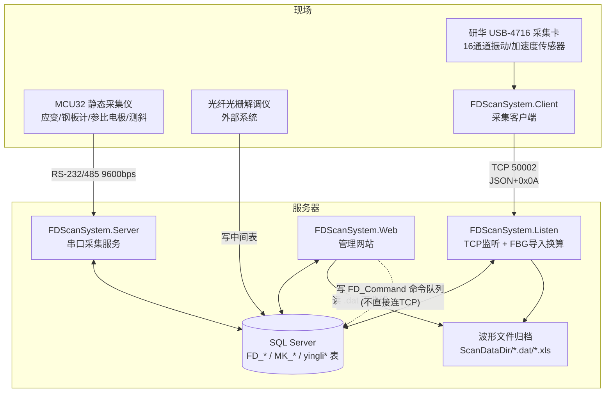
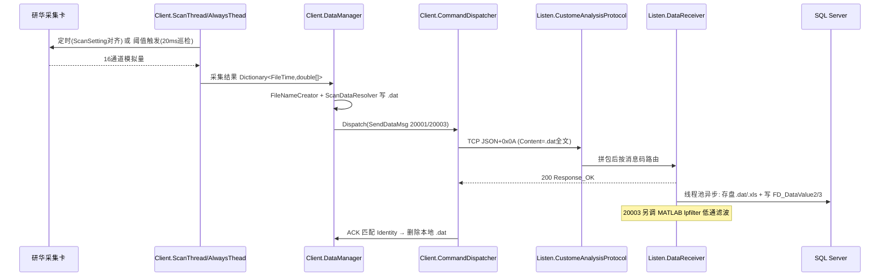
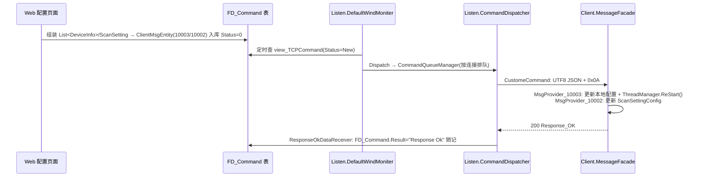
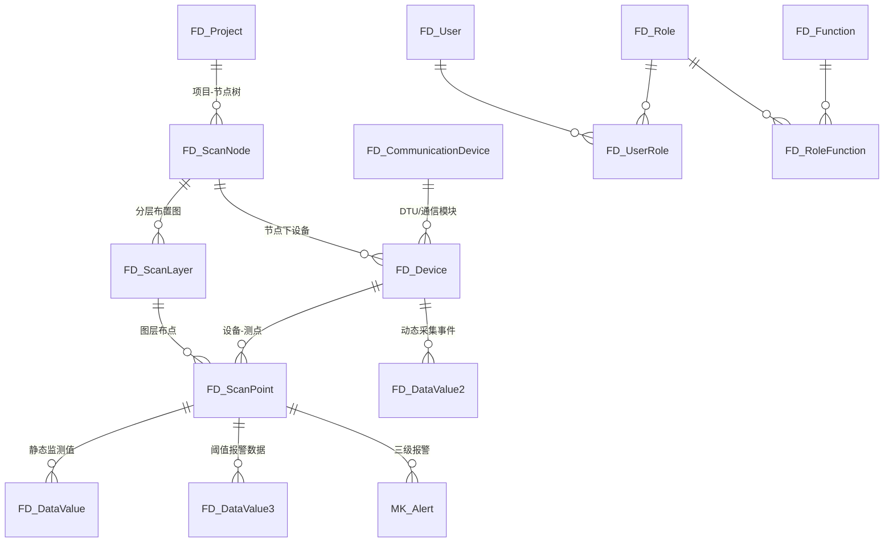

# BH_ScanSystem 业务逻辑关系分析

> 分析对象：`BH_ScanSystem/BH_ScanSystem` 解决方案（12 个项目，约 412 个 C# 源文件）
> 分析日期：2026-11-09
> 说明：本文基于源码与 csproj 编译清单，区分了"活代码"与"遗留/未启用代码"。路径均相对解决方案根目录。

---

## 1. 系统概述

本系统是一套**结构安全监测数据采集与分析平台**，代码源自"中交风电监测系统（FDScanSystem）"，后被复用改造用于**横沙监测项目**（代码中可见 `HSReadMonitor`"横沙读取监视器"、PHC 桩/锚索/环梁测点、光纤光栅(FBG)应力应变换算等横沙专属逻辑）。

系统覆盖两类监测业务：

| 业务线 | 数据源 | 采集方式 | 核心程序 |
|---|---|---|---|
| **动态振动监测** | 研华 USB-4716 采集卡（16 通道模拟量，加速度/振动传感器） | 客户端定时采集 + 阈值触发采集，TCP 上报 | FDScanSystem.Client ⇄ FDScanSystem.Listen |
| **静态/光纤光栅监测** | MCU32 静态采集仪（串口）、FBG 解调仪中间库（yingli* 表） | 串口轮询召测 / 数据库增量导入 + 力学换算 | FDScanSystem.Server、FDScanSystem.Listen |

**核心架构特征**：各运行时程序之间**不直接互相调用**，几乎全部通过 **SQL Server 共享数据库**（配置表、命令队列表 `FD_Command`/`MK_Scan_Command`、数据表）协作；唯一的实时通信链路是采集客户端与 Listen 之间的 TCP 连接（端口 50002）。

---

## 2. 解决方案组成

| 项目 | 类型 | 职责 |
|---|---|---|
| **FDScanSystem.Client** | WinForms 托盘程序（可自装 Windows 服务） | 现场采集端：驱动研华采集卡，定时/阈值采集，落盘 .dat 后 TCP 上报；接收下行配置 |
| **FDScanSystem.Listen** | WinForms 托盘程序 | 网络监听 + 数据导入换算服务：TCP 50002 接收振动数据；定时从 FBG 中间库导入并做温度补偿/力学换算、三级报警（**横沙业务核心**） |
| **FDScanSystem.Server** | WinForms 托盘程序 | 串口主动采集服务：COM 口轮询 MCU32 静态采集仪/Modbus 设备，解析入库 |
| **FDScanSystem.Web** | ASP.NET WebForms（DevExpress 14.1 + MS Chart） | 管理端：RBAC 登录、数据查询/图表、设备/测点/周期配置、命令下发（经 FD_Command 表中转） |
| **FDScanSystem.Protocol** | 类库 | 协议契约：消息码、消息实体 `ClientMsgEntity`、扫描配置实体（ScanConfig）、.dat 数据文件命名与读写（ScanData） |
| **TcpTransmit.Core** | 类库 | 通用异步 TCP 框架（SocketAsyncEventArgs）：连接宿主、收发、重连、空闲剔除；业务经 `IHandler` 注入 |
| **FDScanSystem.DAO** | 类库 | 数据访问：LINQ to SQL（3 个 DataContext）+ Dapper + WisDragon DataCommand 三套并存 |
| **FD_ScanSystem.WebModel** | 类库 | Web 基础设施：页面基类、登录/权限（PassPort/AdminPageBase）、菜单、枚举、缓存、上传 |
| **FDScanSystem.Helper** | 类库 | log4net 封装、WinForms 彩色日志窗、托盘气泡；`Lib/` 为全解决方案第三方 DLL 仓库 |
| **FDScanSystem.FormTest** | WinForms 测试程序 | 采集卡能力验证（InstantAi / BufferedAi 两种模式）、Excel 导出 |
| Backup / packages | — | 旧版备份 / NuGet 包，非业务代码 |

**项目依赖方向**：

```
Client ──┬─→ Protocol ─────────────┐
Listen ──┼─→ TcpTransmit.Core      │
Server ──┘                         ├─→ DAO ─→ WisDragon/ZJFramework10(Lib)
Web ──→ WebModel ──→ DAO           │
Client/Listen/Web ─────────────────┘（均引用 Protocol）
Helper 被所有运行时项目引用（日志 + Lib DLL）
```

---

## 3. 运行时拓扑



> **注意**：Web 与采集客户端之间无直接通信，下行命令经 `FD_Command` 表中转，由 Listen 轮询转发。

---

## 4. 通信协议层（FDScanSystem.Protocol + TcpTransmit.Core）

### 4.1 消息码清单（`FDScanSystem.Protocol/ClientMsgCode.cs`）

| 消息码 | 值 | 方向 | 业务含义 | 实现状态 |
|---|---|---|---|---|
| `Response_OK` | 200 | 双向 | 命令执行成功应答（携带原消息 Identity 关联） | 完整实现，用于停等重传销记 |
| `Response_Error` | 500 | 双向 | 失败应答 | 仅登记，未见发送方 |
| `ServerToClient_Caiji` | 10001 | 下行 | 远程召测（命令客户端立即采集一次） | Client 处理器仅记日志，**未实现实际召测** |
| `ServerToClient_SetPeriod` | 10002 | 下行 | 设置全局采集周期，Content=JSON 的 `ScanSetting` | 完整实现 |
| `ServerToClient_SetPeriod2` | 10003 | 下行 | 设置设备/通道级参数，Content=JSON 的 `List<DeviceInfo>` | 完整实现（Web 四个页面下发） |
| `ServerToClient_ShutDown` | 10011 | 下行 | 重启客户端服务 | **仅定义，无发送/处理代码** |
| `ClientToServer_DataInfo` | 20001 | 上行 | 上报日常定时采集数据 | 完整实现 → `FD_DataValue2` |
| `ClientToServer_DataAlertInfo` | 20003 | 上行 | 上报阈值触发采集数据 | 完整实现 → `FD_DataValue3` + MATLAB 滤波 |

### 4.2 消息格式与传输机制

- **消息实体** `ClientMsgEntity`：`Identity`(GUID) + `Command`(消息码) + `Paramters`(参数字典)。序列化为 **UTF-8 JSON**（经 `ZJFramework10.Serialize.Helper`，内部 Newtonsoft.Json），**帧尾 `0x0A`**。
- 上行参数键：`DEVICEID`、`STARTTIME`(FileTime ticks)、`Interval`、`TDJZPL`/`ZDJZPL`(滤波截止频率)、`Content`(.dat 文件全文)；报警另加 `POINTID`、`ALERTVAL`。
- **TcpTransmit.Core 只做字节流传输**：分隔符打包功能被禁用（`BufferUtils.Delimiter` 为空），消息边界由业务层按尾 `0x0A` 拼包（Client `MessageFacade` / Listen `CustomeAnalysisProtocol`）。⚠️ 一次收到多条完整消息（粘包）时无法正确切分，是已知薄弱点。
- **心跳**：Client 连接成功即发 `0x7B 0x7B 0x7B`（"{{{"）；Listen 检测到 `{{` 结尾判为心跳丢弃。定时心跳代码已注释，实际靠数据上报维持活跃。另有 TCP KeepAlive（5s 探测）与服务端空闲剔除（10 分钟无动作断开）。
- **可靠上传（停等重传）**：Client `CommandDispatcher` 单命令队列，30s 重发，10 次无 ACK 丢弃；**数据先落盘 .dat，收到 200 ACK 后才删除本地文件**，断线不丢数据。Listen 侧对称地用 `CommandQueueManager` 管理下行命令，收到 200 后回写 `FD_Command.Result="Response Ok"` 销记。
- **重连**：Client 无限重连（间隔 5s，`ReconnectAttempts=-1`）。

### 4.3 配置实体（ScanConfig）

| 实体 | 关键字段 | 含义 |
|---|---|---|
| `ScanSetting` | Begin / Interval / ScanTime | 全局采集节拍：起始时刻、间隔(ms)、单次时长(ms) |
| `DeviceInfo` | DeviceId、DeviceIdentity(如 "USB-4716,BID#0")、CommunicationDeviceId、HowLong、Interval、TDJZPL/ZDJZPL、Points | 一台采集设备配置；HowLong>0 时覆盖全局 ScanTime |
| `PointInfo` | PointId、Channel1/2、AlertMin/Max、StandardValue、lingmingValue、Perpiod | 测点：AI 通道号、报警上下限、零点基准、灵敏度（工程值=(读数-StandardValue)/lingmingValue） |

关系：`DeviceInfo 1—N PointInfo`。由 Web 从 `FD_Device`/`FD_ScanPoint` 表组装，经 10003 下发；Client 持久化到本地 `config/device_point_data.txt`、`config/scan_setting.txt`（JSON）。

### 4.4 数据文件层（ScanData）

- `FileNameCreator`：`ScanDataDir/{deviceId}/{yyMMddHH}/{yyMMddhhmmssfff}.dat`，Client 与 Listen 共用规则。
- `ScanDataResolver`：.dat 文本格式（`#` 分隔）——日常数据首行 `deviceId#时间`，数据行 `FileTimeTicks#v1#v2#...`；报警数据首行含 pointId/alertValue。
- 报警数据经 MATLAB 编译组件 `lpfilter.lowpass.lp()` 低通滤波，生成 `-1/-2/-3` 后缀成果文件（时域/频域），供 Web 画曲线。

---

## 5. 核心业务流程

### 5.1 动态振动数据上行（20001 / 20003）



关键类链：
- **定时采集**：`ScanThread`（按 `(Now-Begin)%Interval` 对齐）→ `ScanDataTask`（`InstantAiCtrl.Read(0,16,...)` 循环读 HowLong 毫秒）→ `DataManager`。
- **阈值采集**：`AlwaysThead`（20ms 死循环读 16 通道，按 PointInfo 换算工程值，越 AlertMin/Max 且同点 3 分钟冷却允许 → `ScanDataTaskByAlert` 只录报警通道）。
- **Listen 接收**：`TCPHandller.OnReceived` → `AnalysisProtocolFactory`(恒返回 Custome) → `DataInfoDataReceiver`(20001→FD_DataValue2，ScanEvent="日常-原始") / `AlertDataInfoDataReceiver`(20003→FD_DataValue3，ScanEvent="阀值-原始"，**滤波为活代码**)。

### 5.2 配置下行（Web → FD_Command → Listen → Client）



下发入口页面：`Setting/DeviceList.aspx.cs`、`Setting/Dialog/DeviceEdit.aspx.cs`、`Setting/Dialog/FD_Point_Edit.aspx.cs`、`Setting/ScanPeriodSetting2.aspx.cs`（均生成 10003）；`FD_AutoScanConfig_List.aspx.cs` 下发 MCU32 自记式参数命令；`FD_Command_List.aspx.cs` 手动命令台。

> ⚠️ **当前源码状态**：Listen 中 `Host.DefaultHost.Start()`（TCP 监听）与 `DefaultWindMoniter.Start()`（命令投递 Job）均被注释，此链路"配置齐全但未点火"，需还原代码才生效（见 §8）。

### 5.3 串口静态采集（FDScanSystem.Server）

```
view_ComAutoReadList (DB配置)
  → DataReadJob (每3分钟) 生成 MK_Scan_Command("MCU32 {Identity} Read", Status=New)
  → CommandJob (每30s) 捞 COM 命令 → CommandDispatcher → CommandQueueManager(按COM口排队,单飞)
  → DeviceItem.SendSync(文本)/SendByte(十六进制帧) → 串口 → MCU32/Modbus 设备
  → SerialPort.DataReceived → MCUAnalysisProtocol (拼包状态机: 0x0A文本 / 0x68帧 / 69字节定长帧)
  → Receiver 责任链:
      VersionDataReceiver  应答含 Version= → 序列号匹配 MK_Device, 激活握手
      OKDataReceiver       含 OK → Begin 命令完成, 自动追加 Read 命令(两段式协议)
      WaitDataReceiver     含 WAIT → 重试计数, 超10次判离线
      DetailDataReceiver   数据解析核心: 通道→MK_Point.MapDataName 映射
                           换算 ScanValue5=(value-para1)*para2+para3 (测斜用 Asin 公式)
                           → MK_DataValue 落库 + 镜像测点(NewID)复制
  → 报文回写 MK_Scan_Command.Result, MK_Device.Status=1, CommandIsDone 放行下一条
```

- 断线判定：`TwoWayCommand` 重发 >5 次 → `MK_Device.Status=0`（短信通知代码已注释）。
- `ReConnectJob` 每 20 小时全量重建串口。
- ⚠️ `DetailDataReceiver.getStringTest` 多个点名分支及未启动的 `DataAddJob` 用 `Random` 生成**仿真值**入库（演示/补数逻辑，非真实换算）。

### 5.4 FBG 光纤光栅导入换算（横沙业务核心，Listen.HSReadMonitor，60s）

```
外部 FBG 解调系统 → yingli115 / yingli4 / yingli195 中间表 (SID/SendTime/WaveLength/Result)
  → HSReadMonitor 增量取数 (水位=月表中该点 Max(CreateDate))
  → 工程值换算:
      PHC 桩测点:        ScanValue = Result*0.038 - Para1
      锚索/环梁测点:      温度补偿公式 (Result - 2.3*K*(温补通道波长-基准波长))/(π*r²)*158
                         (温补波长取 yingli4.SID=124/164、yingli115.SID=144、yingli195.SID=234 同时刻值)
      默认:              ScanValue = Result*0.0325 - Para1
  → INSERT FD_DynamicValue3yyyyMM (按月分表, 不存在则自动 CREATE TABLE)
  → Alarm(): 与 MK_Point.MaxNum/MaxNum2/MaxNum3、MinNum* 三级阈值比较
             超限写 MK_Alert {Level=1/2/3, Status=0}
  → setData(): 复制到 NewID 衍生测点(加 Para1 偏置)并同样报警
  → 消费即删: delete from yingli* where SendTime<水位
  → 无新数据 → MK_Device.Status=0 (断线)
```

### 5.5 派生测点二次计算（Listen.OtherReadMonitor，90s）

对虚拟测点（`MK_Point.NewID==0 && MapDataName=="0"`）从月分表取源点同时刻值组合解算：
- `7PHC-*-A`：相邻上下测点均值；`7PHC-*-B/C`：桩身弯矩/曲率类组合公式（含 2.203、0.468 系数）；
- `47PHC-*`：四通道组合（190.788/52.198/0.00262 等系数，Para3~Para6 参与），部分点名带手工偏置修正；
- 其余硬编码 case（7HL-X-13b=0.863×、47HL-*-b=两点均值等）。
结果写回同月表并走 `Alarm` 三级报警。

### 5.6 报警与通知

- **动态阈值报警**：Client 端越限触发采集上报（20003）→ `FD_DataValue3` + 滤波成果。
- **静态/FBG 三级报警**：Listen `Alarm()` → `MK_Alert`（Level 1/2/3）。
- **展示端获取报警**：Web 直接查库，无主动推送。
- **短信**：`Models/Send.cs` 经蓝凌网关（dxjk.51lanz.com）HTTP POST；Server/HSReadMonitor 中调用已注释，仅遗留的 FBGMonitor 仍活调。

---

## 6. 数据库设计

### 6.1 连接配置（注意三程序连接串不一致）

| 程序 | 连接名 | 配置中的库名 |
|---|---|---|
| Web | DataConnection | `FD_ScanCenter` |
| Listen | DataConnection | `TC_Monitor`（注释称"振动倾斜监测数据库"） |
| Server | DataConnection | `FD_ScanSystem` |

> 三个库名不同，可能指向同一物理库的不同部署配置，**接手时需核对实际部署**。所有 DataContext 创建时执行 `SET TRANSACTION ISOLATION LEVEL READ UNCOMMITTED`（脏读换吞吐）。

### 6.2 核心表关系



### 6.3 表清单（按用途分组）

**配置与组织**
| 表 | 说明 |
|---|---|
| FD_Project | 项目 |
| FD_ScanNode | 风机/结构节点树（ParentId 自关联，MapX/Y 首页布点） |
| FD_ScanLayer | 节点分层布置图（背景图 ImageLocation） |
| FD_CommunicationDevice | 通信设备 DTU（IP/Port/CommunicationCode，Listen 按 IP 识别客户端） |
| FD_Device | 采集设备（DeviceIdentity 采集卡标识、Perpiod/HowLong/TDJZPL/ZDJZPL 动态参数） |
| FD_ScanPoint | 测点核心配置（Channel1/2、AlertMin/Max、Other1=零点/Other2=灵敏度、para1~6 换算参数、NewID 换点续接） |
| FD_Dict | 通用字典（DictType=SCANTYPE 监测类型） |
| FD_Scan_Setting | 全局采集周期（Static/Dynamic） |

**数据**
| 表 | 说明 |
|---|---|
| FD_DataValue | 静态监测值（ScanValue~ScanValue6，5/6 为计算值列） |
| FD_DataValue2 | 动态采集事件（ScanEvent="日常-原始"，**原始波形外挂 ScanLocation 指向 .dat 文件**） |
| FD_DataValue3 | 阈值报警采集数据（ScanEvent="阀值-原始"） |
| FD_DynamicValue2**yyyyMM** | 动态特征值**按月分表**（MAXValue/YXValue/AverageValue 等，运行时自动建表） |
| FD_DynamicValue3**yyyyMM** | 横沙 FBG 换算成果月表（WaveLength/Result/ScanValue，HSReadMonitor 自动建表） |
| MK_DataValue / MK_Alert / MK_Point / MK_Device 等 | MK 系列：Server 串口采集与 Listen FBG 报警所用（另一期/静态业务表） |
| yingli115 / yingli4 / yingli195 | FBG 解调中间表（外部系统写入，Listen 消费即删） |

**命令与日志**
| 表 | 说明 |
|---|---|
| **FD_Command** | Web→Listen→Client 命令队列表（Command 存序列化 ClientMsgEntity，Status/Result 跟踪） |
| MK_Scan_Command | Server 串口命令队列 |
| view_TCPCommand | FD_Command ⋈ IP/Port，Listen 取待发送命令的视图 |
| FD_Connection_Log | 采集端 TCP 连接/断开日志 |

**权限（RBAC）**：FD_User、FD_Role、FD_UserRole、FD_Function、FD_RoleFunction；附件：FD_FileUpload（月报/申报）。

**遗留库**（DAO DB1/DB2 DataContext）：光纤光栅频谱库 `ChNo1_0~35`/`ChNo2_0~35` 共 72 张同构表；FBG 库 `FBG_Data`(V001~V050)。对应 Listen 中未启动的 DataReadMoniter/FBGMonitor。

### 6.4 数据访问方式（DAO，三套并存）

1. **LINQ to SQL**（主力）：DBDataContext(FD_*/MK_*)、DB1DataContext(光纤通道)、DB2DataContext(FBG)。
2. **Dapper**：`Scan/ServerDAL.cs` —— Server 串口设备清单、测点映射、数据去重。
3. **WisDragon DataCommand**：`Sys_Permission_Logic.cs` + `Configuration/Auto/Sys_Permission.config` 配置化 SQL，负责 RBAC 约 30 个方法。

---

## 7. Web 管理端功能模块（FDScanSystem.Web）

技术栈：WebForms + DevExpress + MS Chart；**无 WebAPI/ashx，全部 .aspx 页面回调**；页面基类/登录/菜单来自 WebModel。

| 模块 | 页面 | 功能 |
|---|---|---|
| 登录导航 | Login / Index / Site.Master | RBAC 登录；首页按 FD_ScanNode.MapX/Y 在平面图布点，点击进分层图 |
| 静态数据 | DataInfo/StaticDataQuery、StaticCalQuery、StaticDataChart、StaticCalChart | 静态监测值查询/过程线/应力应变温度双图，XLS 导出，NewID 换点续接 |
| 分层展示 | FD_LayerImage | 分层背景图 + 测点布点，点击进测点曲线 |
| 动态数据 | DynamicDataQuery(Detail)、DynamicDataAlertQuery(Detail)、DynamicSimpleQuery/List、DataChart | 采集事件列表、.dat 时域/频域曲线、报警数据、月分表特征值查询 |
| 数据补录 | Dialog/DataStaticAdd、DataStaticEdit | 手工增改静态数据 |
| 附件 | FileUpload_List/Edit、FileDownload | 月报/申报附件管理 |
| 采集配置 | Setting/FD_ScanNode、FD_ScanLayer、FD_ScanType、FD_CommunicationDevice、DeviceList/DeviceEdit、FD_Point_List/FD_Point_Edit | 节点/图层/类型/通信设备/设备/测点 CRUD；保存即组装 10003 写 FD_Command 下发 |
| 周期与命令 | ScanPeriodSetting(2)、FD_AutoScanConfig_List、FD_Command_List、FD_Connection_List | 静态/动态采集周期、MCU32 自记式参数、手动命令台、连接日志 |
| 系统权限 | Sys/FD_User*、FD_Role*、RoleFunction | 用户/角色/功能授权 |

波形曲线数据源：`DataProcess/DataTemplateFacade` 直接解析服务器磁盘 .dat 文件（ScanDataResolver + MemoryCache 60min 缓存），Excel 下载由 ScanLocation 路径映射。

---

## 8. 代码现状与风险标注

接手/维护时需特别注意以下事实（均经源码与 csproj 核实）：

### 8.1 未启用/死代码
| 项 | 现状 |
|---|---|
| Listen `Host.DefaultHost.Start()` | **被注释**——TCP 50002 监听当前不启动，Listen 实际是纯 DB 轮询换算服务 |
| Listen `DefaultWindMoniter` / `UDPWIndMoniter` | 被注释未启动（下行命令投递、UDP 地震预警链路） |
| Server `Device/TCPHandller.cs` | 不在 csproj 编译清单，从 Listen 抄来的遗留文件；Server 无 TCP 功能 |
| Listen `Analysis/MCU/*` 族 | 编译但工厂恒返回 Custome 协议，MCU 分支不可达 |
| 10001 远程召测 / 10011 重启 | 有定义无实现 |
| WinServices 服务壳 | OnStart 仅写日志，业务全在 WinForms 加载回调；Client 服务名残留 "ExcelConverterServices" |
| App_Start/IdentityConfig、Models/IdentityModels | ASP.NET Identity 模板残留，无业务 |
| DataReadMoniter(5694行)/FBGMonitor/SqlspliterRead | 风电项目/SQLite 遗留导入任务，未启动 |

### 8.2 数据真实性
- Server `DetailDataReceiver.getStringTest` 多个点名分支、`DataAddJob` 用 `Random` 造仿真值入库；
- Listen `OtherReadMonitor` 对 47PHC-2-* 有手工偏置修正（+1、/2-5 等）——部分"监测值"为演示或人工调校产物。

### 8.3 安全隐患
- 各 app.config/Web.config 含**明文 sa 密码**与短信网关凭据；
- Web `DynamicSimple*` 页面与 Listen 月表操作使用**字符串拼接 SQL**（注入面）；
- `PassPort.IsAuthenticated` 硬编码 return true（鉴权实际靠 FunctionRights）；
- 全部 DataContext 使用 READ UNCOMMITTED 脏读；Sys_Permission_DAL 全部吞异常。

### 8.4 协议/工程缺陷
- TCP 传输层分隔符被禁用，业务层只处理"尾 0x0A"情形，**粘包无法正确切分**；
- `ClientMsgEntity.AddParameter` 的 ContainsKey 分支逻辑写反（未触发）；
- 多处拼写遗留：`Paramters`、`Perpiod`、`lingmingValue`、`TCPHandller`；
- Server 与 Listen 的 FormTitle/服务名同为 `FD_ScanServer`，同机安装服务会撞名；
- 三个程序数据库连接串库名不一致（FD_ScanCenter / TC_Monitor / FD_ScanSystem），部署时需核对。

---

## 9. 关键代码位置索引

| 关注点 | 位置 |
|---|---|
| 消息码定义 | `FDScanSystem.Protocol/ClientMsgCode.cs` |
| 消息实体/序列化 | `FDScanSystem.Protocol/ClientMsgEntity.cs` |
| 配置实体 | `FDScanSystem.Protocol/ScanConfig/{ScanSetting,DeviceInfo,PointInfo}.cs` |
| .dat 文件规则 | `FDScanSystem.Protocol/ScanData/{FileNameCreator,ScanDataResolver}.cs` |
| TCP 框架宿主 | `TcpTransmit.Core/{BaseConnectionHost,Server/Host,Client/Host,Client/HostManager}.cs` |
| Client 采集线程 | `FDScanSystem.Client/Logic/ThreadManager/{ScanThread,ScanDataTask,AlwaysThead,DataManager}.cs` |
| Client 消息路由/发送 | `FDScanSystem.Client/Logic/{MessageFacade,TCPHandler}.cs`、`Logic/MsgSender/{MsgCenter,SendDataMsg}.cs`、`Logic/MsgProvider/*` |
| Listen TCP 接入 | `FDScanSystem.Listen/Device/{TCPHandller,ConnectionInitManager,DeviceConnectionManager}.cs` |
| Listen 协议解析 | `FDScanSystem.Listen/Analysis/Custome/CustomeAnalysisProtocol.cs` |
| Listen 数据接收 | `FDScanSystem.Listen/Analysis/DataReceiver/Custome/{DataInfoDataReceiver,AlertDataInfoDataReceiver,ResponseOkDataReceiver}.cs` |
| 横沙 FBG 换算 | `FDScanSystem.Listen/Logic/HSReadMonitor.cs` |
| 派生测点计算 | `FDScanSystem.Listen/Logic/OtherReadMonitor.cs` |
| Server 串口管理 | `FDScanSystem.Server/Device/{DeviceConnectionManager,DeviceItem}.cs` |
| Server 报文解析 | `FDScanSystem.Server/Analysis/MCU/MCUAnalysisProtocol.cs`、`Analysis/DataReceiver/MCU/DetailDataReceiver.cs` |
| Server 定时任务 | `FDScanSystem.Server/Job/{DataReadJob,CommandJob,ReConnectJob}.cs` |
| Web 配置下发 | `FDScanSystem.Web/Setting/{DeviceList,ScanPeriodSetting2}.aspx.cs`、`Setting/Dialog/{DeviceEdit,FD_Point_Edit}.aspx.cs` |
| Web 曲线解析 | `FDScanSystem.Web/DataInfo/DataProcess/DataTemplateFacade.cs` |
| RBAC 数据访问 | `FDScanSystem.DAO/Sys_Permission_Logic.cs` + `Configuration/Auto/Sys_Permission.config` |
| 短信网关 | `FDScanSystem.{Server,Listen}/Models/Send.cs` |